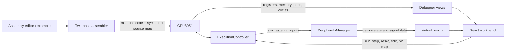

<div align="center">


# Micro8051SiM

### An 8051 assembly workbench, CPU simulator & virtual electronics lab

**Write. Assemble. Execute. Inspect. Experiment.**

[Overview](#-what-is-micro8051sim) · [Capabilities](#-inside-the-workbench) · [Architecture](#-how-it-works) · [Quick start](#-get-running-locally) · [Development](#-development)

[](https://react.dev/)
[](https://www.typescriptlang.org/)
[](https://vite.dev/)
[](https://tailwindcss.com/)
[](#-license)

</div>

---

## What is Micro8051SiM?

Micro8051SiM is a browser-based environment for learning and experimenting with the **classic 8051 microcontroller**. It brings an assembly editor, assembler, software CPU model, execution controls, debugger views and simulated peripherals into one integrated workbench.

Instead of treating assembly as a sequence of opaque instructions, the simulator connects code execution to observable processor state and virtual hardware. Step through an instruction, inspect the registers and memory it changes, then follow the resulting port activity on the virtual bench.

It is designed for:

- **Students** learning 8051 architecture, assembly language, timers, serial I/O and interfacing.
- **Educators** demonstrating processor state and peripheral behaviour without requiring a physical board for every lesson.
- **Developers and hobbyists** prototyping small 8051 assembly routines and exploring the simulator's execution model.

> **Scope:** this is a software simulation and learning tool. It does not connect to, program or electrically validate a physical 8051 board. Peripheral behaviour is modelled in software and should not be treated as a substitute for a hardware datasheet or bench measurement.

## Inside the workbench

### One engine, three learning depths

| Workspace | What it emphasizes |
| --- | --- |
| **Beginner** | Guided assembly workflow, starter snippets, registers, basic memory, LEDs, switches, LCD and step-by-step learning support. |
| **Intermediate** | A broader editor/debugger workflow with interactive virtual hardware, breakpoints and peripheral experiments. |
| **Advanced** | Split editor/disassembly, CPU and memory inspection, oscilloscope, UART terminal, frequency analysis and detailed timing-oriented views. |

### Assembly and build pipeline

- Two-pass assembly with labels and symbol resolution.
- Source-line/address mapping for navigating between code and machine addresses.
- Assembler diagnostics and generated disassembly.
- Directives and data definitions including `ORG`, `EQU`, `DB`, `DW` and `END`.
- Instruction families covering data movement, arithmetic, logic, bit operations, branches, calls/returns, stack operations and external-memory access.

The assembler and CPU implementation include the classic 8051 mnemonic set represented in the source: `ACALL`, `ADD`, `ADDC`, `AJMP`, `ANL`, `CJNE`, `CLR`, `CPL`, `DA`, `DEC`, `DIV`, `DJNZ`, `INC`, `JB`, `JBC`, `JC`, `JMP`, `JNB`, `JNC`, `JNZ`, `JZ`, `LCALL`, `LJMP`, `MOV`, `MOVC`, `MOVX`, `MUL`, `NOP`, `ORL`, `POP`, `PUSH`, `RET`, `RETI`, `RL`, `RLC`, `RR`, `RRC`, `SETB`, `SJMP`, `SUBB`, `SWAP`, `XCH`, `XCHD` and `XRL`.

### CPU state and debugging

- 8-bit accumulator and B register, 16-bit data pointer and program counter, stack pointer and PSW flags.
- Four register banks with the active bank selected through PSW bits.
- Internal RAM, SFR space, code memory and 64 KB external data memory (XRAM) represented in the CPU state.
- Port latches and external pin state kept separately so input devices can influence the simulated pins.
- Instruction stepping, run/pause/stop/reset, step-over, configurable execution speed and breakpoints.
- CPU status, disassembly, register, SFR and memory inspection views.
- Execution statistics including instruction count, machine cycles and last instruction cycle cost.

### Virtual electronics bench

| Component / instrument | Simulation role |
| --- | --- |
| LED array and DIP switches | Observe port outputs and drive digital inputs. |
| 16×2 LCD | Exercise LCD control and data-pin signalling. |
| Four-digit 7-segment display | Explore segment encoding and multiplexed digit selection. |
| 4×3 matrix keypad | Test row/column scanning and key input. |
| DC motor | Visualize direction and enable control through simulated driver pins. |
| UART terminal | Inspect transmitted serial data and send input bytes. |
| DAC and ADC input | Explore digital/analogue value conversion in the software model. |
| Oscilloscope | Observe the simulated DAC waveform and ADC/comparator signals. |
| Frequency analyzer | Probe selected pins and inspect signal metrics. |
| Analog comparator | Compare the virtual input voltage with the DAC output. |

Pin mapping is configurable through the pin-mapper interface. The peripheral manager synchronizes external inputs into CPU pins before execution and updates visual outputs from CPU port state after execution.

### Learn by running real assembly examples

The repository includes **23 example programs** spanning topics such as:

- LED blink, binary counter and chaser patterns.
- Switch input, LCD output and 7-segment multiplexing.
- Timer delays and timer interrupts.
- UART transmit, receive and echo workflows.
- DC motor control and DAC waveform generation.
- Arithmetic/BCD operations, frequency generation and PWM.
- Comparator-based ramp and successive-approximation ADC examples.
- Synchronous and asynchronous serial signalling.

Examples are defined in [`src/examples/examples.ts`](src/examples/examples.ts) and can be launched from the application.

## How it works

The application is organized around a small simulation pipeline. The UI owns the interaction state, while the CPU, execution controller and peripheral manager hold the simulation responsibilities.



### Runtime sequence

1. The user writes assembly or loads an example.
2. `assemble8051()` parses and resolves the source, then returns machine code, diagnostics, symbols, disassembly and source/address mappings.
3. The CPU loads the assembled bytes into code memory.
4. `ExecutionController` schedules execution and manages run state, breakpoints and UI update cadence.
5. Before an instruction executes, the peripheral manager applies virtual external inputs to the CPU's port pins.
6. After execution, the peripheral manager derives output-device state from the CPU's port latches.
7. React views render the updated CPU, memory, console and virtual instrument state.

### Codebase map

```text
micro8051simadvance/
├── .github/
│   └── workflows/
│       └── deploy.yml            # GitHub Pages build and deployment
├── docs/
│   └── architecture.svg         # README architecture illustration
├── src/
│   ├── App.tsx                  # Application state and orchestration
│   ├── main.tsx                 # React entry point
│   ├── core/
│   │   ├── assembler/           # Two-pass assembler
│   │   ├── cpu/                 # 8051 CPU state and instruction execution
│   │   ├── instruction-set/     # Disassembler
│   │   ├── tests/               # CPU and assembler self-tests
│   │   └── types.ts             # Architecture and simulator types
│   ├── simulator/
│   │   └── execution-controller.ts
│   ├── peripherals/             # Pin mapping, LCD, frequency and I/O model
│   ├── examples/                # Built-in assembly programs
│   └── components/
│       ├── advanced/            # Timing-focused panels
│       ├── beginner/            # Beginner register view
│       ├── common/              # Reusable UI primitives
│       ├── debugger/             # Registers, memory, SFR and disassembly
│       ├── editor/              # Assembly editor
│       ├── explorer/            # Project/example explorer
│       ├── help/                # Instruction reference
│       ├── home/                # Landing and level selection
│       ├── layout/              # Header, toolbar, console and status bar
│       ├── learn/               # Learning hub
│       ├── pin-mapper/          # Peripheral pin configuration
│       ├── settings/            # User preferences
│       ├── views/               # Beginner, Intermediate and Advanced workspaces
│       └── virtual-bench/       # Simulated instruments and devices
├── index.html
├── package.json
├── tsconfig.json
└── vite.config.ts
```

## Get running locally

### Prerequisites

- **Node.js 22 or newer** (the deployment workflow uses Node.js 22).
- npm.
- Git (optional, if cloning the repository).

### 1. Clone the repository

```bash
git clone https://github.com/<your-username>/<your-repository>.git
cd <your-repository>
```

Or download and extract the repository ZIP.

### 2. Install dependencies

```bash
npm install --legacy-peer-deps
```

The repository currently does not include a lockfile, so `npm ci` is not available as a reproducible install path until a lockfile is committed.

### 3. Start the development server

```bash
npm run dev
```

Open **http://localhost:3000** in your browser. Vite serves the app with hot module replacement enabled by default.

### 4. Build and preview

```bash
npm run build
npm run preview
```

The production bundle is generated in `dist/`.

## Development

### Available scripts

| Script | Description |
| --- | --- |
| `npm run dev` | Start Vite on port `3000`, listening on all interfaces. |
| `npm run build` | Create the production bundle in `dist/`. |
| `npm run preview` | Preview the production build locally. |
| `npm run lint` | Run the TypeScript compiler in no-emit checking mode (`tsc --noEmit`). |
| `npm run clean` | Remove `dist/` and `server.js` (uses a Unix-style `rm` command). |

### CPU self-tests

The CPU self-test suite currently contains **8 checks** covering representative execution paths:

- Immediate/register movement and register-bank behaviour.
- Arithmetic and PSW flags.
- `MUL AB` and `DIV AB`.
- Subroutine calls, returns and stack behaviour.
- Conditional branching and loop countdown.
- Bit operations and port writes.
- Upper internal RAM and external XRAM access.

The application invokes these checks during startup and logs a success summary when every check passes. The current startup code does not print individual failure details. There is no dedicated `npm test` script in the current package configuration.

### Continuous deployment

The workflow in [`.github/workflows/deploy.yml`](.github/workflows/deploy.yml) builds and deploys the Vite output to **GitHub Pages** when code is pushed to the `main` branch, or when the workflow is manually dispatched.

To enable deployment:

1. Push the repository to GitHub.
2. Open **Settings → Pages**.
3. Set the build/deployment source to **GitHub Actions**.
4. Ensure Actions are enabled, then push to `main` or run the workflow manually.
5. Check the workflow run and its deployment summary for the published URL.

The workflow uses the repository's `GITHUB_TOKEN` with the declared Pages permissions; a personal access token is not required for this workflow.

## Engineering notes & current boundaries

A few details are worth making explicit for anyone extending the simulator:

- **Simulation fidelity:** CPU and peripheral behaviour are implemented in TypeScript. Validate timing-sensitive or electrical behaviour against the target 8051 variant and physical hardware before relying on it outside learning/prototyping.
- **Device scope:** the current virtual bench is a software model. It does not provide USB, serial-adapter or physical-board connectivity.
- **Test coverage:** the built-in self-tests are useful smoke checks, not a complete conformance suite for every opcode, addressing mode, interrupt edge case or peripheral timing condition.
- **AI dependency:** `@google/genai` appears in the dependency manifest, but no application source import or active Gemini integration was found in the inspected source tree. Do not assume an AI feature is configured or available based on that dependency alone.
- **Reproducibility:** no package lockfile is present in the supplied repository snapshot. Add and commit one if deterministic dependency installation is required.
- **Cross-platform clean command:** `npm run clean` uses `rm -rf`, which is native to Unix-like shells and may need an alternative on Windows.

## Contributing

Contributions that improve instruction correctness, simulator observability, learning workflows, peripheral models, accessibility or test coverage are welcome.

A practical contribution workflow:

1. Open an issue describing the behaviour, bug or learning problem.
2. Keep changes focused and preserve clear boundaries between CPU logic, execution scheduling, peripheral modelling and UI.
3. Add or extend tests for CPU, assembler or peripheral behaviour where possible.
4. Run `npm run lint` and `npm run build` before opening a pull request.
5. Include reproduction steps and screenshots or short recordings for user-facing changes.

## License

No `LICENSE` file was present in the inspected repository snapshot. Until a license is added, the project should be treated as **all rights reserved**; do not assume that public availability grants permission to reuse, redistribute or modify it.

---

<div align="center">

**Micro8051SiM** · Understand the machine, one instruction at a time.

<sub>Project credits in the current application metadata: Vineet Sharma and Chaman Vashishth.</sub>

</div>
